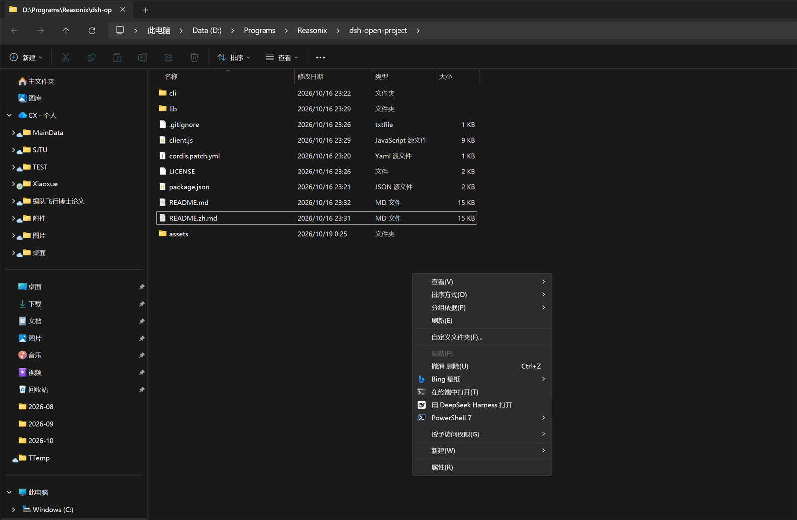
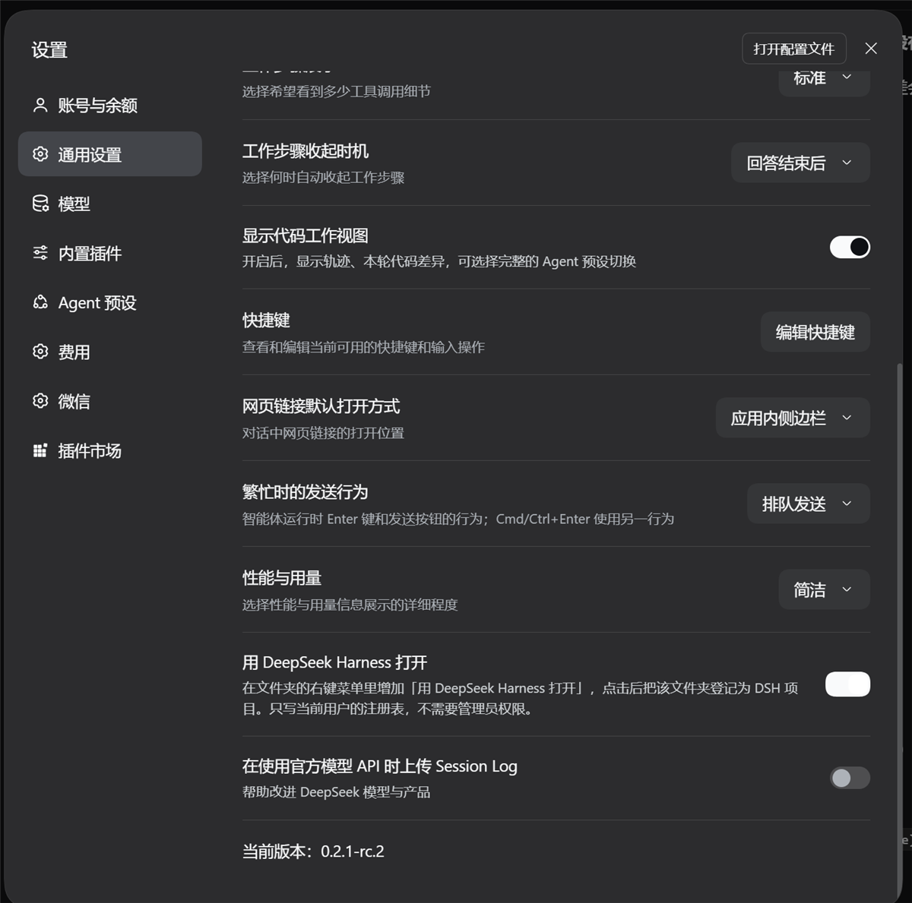

# dsh-open-project

> **当前版本：1.4.0** —— 见[更新记录](#更新记录)。如果你装的是旧版本，建议更新：1.2.0 会把 DSH
> 窗口带到最前，1.3.x 能从非默认安装目录启动应用，并且不再静默失败。

一个 Windows 上的 DSH 插件：给资源管理器的文件夹右键菜单加上「用 DeepSeek Harness 打开」，
点一下就把该文件夹登记成 DSH 侧边栏里的一个项目；并在 DSH 的**设置 → 通用**里加一个开关，
用来随时添加或删除这个菜单项。

它是 DSH 的双半插件：

| 半边 | 文件 | 职责 |
| --- | --- | --- |
| 宿主 | `lib/index.js` | 在 DSH 的 web 服务上注册两条精确路由：一条把目录登记为项目，一条读取/切换右键菜单项。 |
| 客户端 | `client.js` | 在通用设置页渲染一行设置项，右侧开关调用切换路由。 |
| Windows 脚本 | `cli/` | 写注册表的 `context-menu.ps1`、共享的可执行文件查找 `app-path.ps1`，以及右键菜单点击后真正执行的那个启动脚本。 |

## 效果

**资源管理器里。** 右键一个文件夹（或文件夹内的空白处），菜单里会出现「用 DeepSeek Harness
打开」。选中后该文件夹被加入 DSH 的项目列表、**把 DSH 窗口带到最前面**（从托盘或最小化状态
恢复），并弹出一条 Windows 通知：

- `Opened as a DSH project` —— 登记成功，通知第二行是这个项目的标题；
- `Already a DSH project` —— 该目录已经有项目，什么也没改。

"把窗口带到前面"是故意做的一步：登记项目本身不会改变屏幕上的任何东西，少了这一步，用户点了会觉得
"什么都没发生"。

DSH 没在运行时，它会先把应用启动起来：定位可执行文件（依次是 `DSH_DESKTOP_APP_EXE`、正在运行的
实例、安装程序注册的 `dsh://` 协议处理命令、默认安装位置），拉起应用，等窗口出现并把它带到前面，
然后在宿主就绪后登记该文件夹。整个等待过程有上限（180 秒）。

**DSH 里。** 设置 → 通用会多出一行：中文浏览器下是「用 DeepSeek Harness 打开」，其他语言下是
**Open in DeepSeek Harness**。说明文字讲了两件事——开关只写当前用户的注册表（不需要管理员权限）；
以及 DSH 换了位置之后，把开关关掉再打开一次就会按新路径重新注册。这一行的位置在原有的「显示代码
工作视图」与版本号两行之间。开关打开就写入两个注册表键，关闭就删除。宿主不是 Windows 时，这一行
完全不渲染。

**截图。** Windows 11，DSH 桌面版 0.2.1-rc.2。





## 环境要求

- **Windows 10/11。** 整个功能就是资源管理器加 `HKCU` 注册表这一套机制。
- **PowerShell——两个版本都行，不用装任何东西。** Windows 10/11 自带的 Windows PowerShell 5.1
  就够用：脚本刻意避开了只有 7 才接受的语法，并保存为带 BOM 的 UTF-8，好让 5.1 正确解码其中
  非 ASCII 的默认标题。装了 PowerShell 7 时优先用 7，因为启动大约快三倍。用户能看到的差别只有
  成功通知：5.1 能投影 WinRT，弹的是真正的 Windows 通知；7 则回退成托盘气泡。
- **`wscript.exe`**（Windows 自带）——菜单命令经它拉起，这样不会闪控制台窗口。
- **一个组合了本插件的 DSH profile**，并且提供 `webServer` 与 `workspaceRegistry` 两个服务——
  也就是 DSH 桌面版自己用的那两个（侧边栏的项目列表就建立在工作区注册表上）。缺任何一个，
  插件会保持 pending，不会半挂载。

## 安装

**在 DSH 应用里（推荐）。** 打开侧边栏的 **Plugins**（插件）页 → **添加插件**，填其中之一：

```
dsh-open-project
github:dongfangxy/dsh-open-project
```

插件管理器会装好这个组合包并默认启用。第一种走 profile 使用的 npm 源（包需要已经发布到该源），
第二种直接从仓库拉取。

**在 `dsh` 命令行里**，针对你自己启动的 profile：

```powershell
dsh plugin --profile <profile> add dsh-open-project
dsh plugin --profile <profile> add github:dongfangxy/dsh-open-project
```

`--profile` 是必需参数——`dsh plugin` 把参数转发给 pnpm，在 `$DSH_HOME/profiles/<profile>` 里执行。
（应用里的安装对话框把包名描述成「README 里 `dsh plugin add` 后面那一段」，那是**包名**，
不是整条命令。）DSH 桌面版加载的是它自己保留的 profile，所以桌面版请走 Plugins 页安装。

如果设置里那一行没有自己出现，重启 DSH。

## 使用

1. 在 DSH 里打开**设置 → 通用**，把「用 DeepSeek Harness 打开」打开。这一步只写注册表项，
   别的都不动。
2. 在资源管理器里右键一个文件夹（或文件夹内的空白处），选**用 DeepSeek Harness 打开**。
3. 该文件夹成为 DSH 侧边栏里的一个项目。在侧边栏打开它并新建会话，这个会话就在该项目目录下运行。
4. 不想要这一项时，把同一个开关关掉即可。每次打开设置页，开关状态都是从注册表重新读出来的。

也可以直接用脚本切换：

```powershell
powershell -NoProfile -ExecutionPolicy Bypass -File cli/context-menu.ps1 -Action status            # 人类可读的状态报告
powershell -NoProfile -ExecutionPolicy Bypass -File cli/context-menu.ps1 -Action status -Json      # 一行 JSON（宿主读的就是它）
powershell -NoProfile -ExecutionPolicy Bypass -File cli/context-menu.ps1 -Action enable
powershell -NoProfile -ExecutionPolicy Bypass -File cli/context-menu.ps1 -Action disable
```

`-Title 'Open in DeepSeek Harness'` 可以换一个菜单标签。设置页的开关不传标题，所以它写进去的
永远是默认的中文标签。

## 它到底做了什么

它没有藏着别的行为，下面是完整链路。

**点击右键菜单。** 注册表里的命令是 `wscript.exe //nologo`，后面跟 `cli/open-project-in-dsh.vbs`
的绝对路径，并把点中的文件夹（`%V`）作为参数传进去；它再用隐藏窗口拉起
`cli/open-project-in-dsh.ps1`。该脚本：

1. 解析这个文件夹；路径不存在或不是目录时弹一个警告框并退出（退出码 2）；
2. 确定 DSH 的基地址——会话提供了 `DSH_WEB_URL` 就用它，否则找正在运行的
   `DeepSeek Harness` 进程监听的回环端口，再否则用 `http://127.0.0.1:19387`；
3. 应用没在运行时先启动它，用的可执行文件由 `cli/app-path.ps1` 查找
   （`$env:DSH_DESKTOP_APP_EXE` → 运行中实例自己的映像路径 → 默认的按用户与按机器安装位置）；
   一个都找不到时给出说明并退出（退出码 3）；
4. 把 `{"path": "<文件夹>"}` `POST` 到 `/.dsh-open-project`，失败就重试，直到超时
   （应用本来就在跑等 30 秒，由它启动应用则等 180 秒）。403 之外的 4xx 视作终态，不再重试；
5. 反馈结果：成功弹 Windows 通知，失败弹消息框。

**登记。** `POST /.dsh-open-project` 由宿主半边处理，它调用
`ctx.workspaceRegistry.create(<文件夹>)`。这就是 DSH 自己的工作区注册表：它写入一条 workspace
记录——默认桌面版安装中，`$DSH_HOME/storages/workspace.json` 是这个注册表的持久化存储
（unit 名为 `workspace`，版本 2）。登记是幂等的：该目录已有项目时，直接返回原记录，不改标题。
这条记录就是一个**项目**，即侧边栏项目列表里的一项；它本身不保存文件内容，也不保存会话数据。

**设置里的那一行。** `client.js` 注册进 `settings.general.item` 插槽，行内文案按浏览器语言在
中英之间取一套（`navigator.language` 以 `zh` 开头取中文，其余取英文）；它用
`GET /.dsh-open-project/menu` 读当前状态，用 `POST /.dsh-open-project/menu` 加
`{"enabled": true|false}` 改状态。宿主路由对读请求执行
`cli/context-menu.ps1 -Action status -Json`，对写请求执行 `-Action enable|disable`；宿主不是
Windows 时则直接回答 `supported: false`，连 PowerShell 都不运行。客户端据此完全不渲染这一行。
写失败时，设置行会回读真实状态，而不是显示成已经改好了。

**注册表项。** `cli/context-menu.ps1` 只写两个键：

```
HKCU\Software\Classes\Directory\shell\OpenInDeepSeekHarness
HKCU\Software\Classes\Directory\Background\shell\OpenInDeepSeekHarness
```

每个键写一个默认值（菜单标签）；能找到应用可执行文件（同一个 `cli/app-path.ps1` 查找）时再写
一个 `Icon` 值；并建一个 `command` 子键，默认值就是上面那条 `wscript.exe` 命令。`disable` 会把
两个键连同子键一起删掉。

## 限制

- **它不会改变任何工作目录。** 登记一个文件夹只是新增一条项目记录。会话的工作目录是 DSH 自己
  的事，与本插件无关：从某个项目新建会话时，DSH 用该项目目录作为该会话的目录；否则用宿主进程
  自己的目录（`process.cwd()`），而后者在应用启动时就定下来了。插件从不设置或修改 `cwd`，不会
  给应用换目录，也无法移动一个已经在运行的会话。它做的事是让这个文件夹**成为可选的项目**；
  之后你从该项目新建的会话之所以跑在那个目录下，是 DSH 的行为，而不是菜单项改动了什么。
- **仅限 Windows。** 其他平台没有资源管理器右键菜单、没有 `HKCU`、也没有 `wscript.exe`。
  宿主在那里返回 `supported: false`，客户端那一行完全不渲染——所以设置里不会冒出一个注定
  用不了的开关。
- **每个动作都要启动一次 PowerShell**，所以点菜单和每次拨动设置开关都要付一次进程启动开销
  （PowerShell 7 约 0.2 秒，5.1 约 0.8 秒）。
- **冷启动要求能找到应用可执行文件。** `cli/app-path.ps1` 依次查 `DSH_DESKTOP_APP_EXE`、正在
  运行的实例、安装程序注册的 `dsh://` 协议处理命令、默认的 Electron 安装位置。协议注册项覆盖了
  装在自定义目录里的情况；两者都没有的安装才需要设 `DSH_DESKTOP_APP_EXE`。受影响的只有
  「启动」这一步；只要有一个实例在跑，登记就照常工作。
- **菜单图标是尽力而为的。** 决定图标的是同一个查找。一个都找不到时不写图标（删掉 `Icon` 值），
  菜单照常可用。
- **截图来自 DSH 桌面版 0.2.1-rc.2**（见[效果](#效果)）；这一行的具体样式跟随应用自己的设置列表，
  以后版本可能变化。
- **设置行跟随浏览器语言，通知和菜单标签不跟随。** 设置行按浏览器语言在中英之间切换；而成功
  通知、启动提示和失败对话框都由 `cli/open-project-in-dsh.ps1` 发出，文案固定为英文。文件夹菜单
  的标签由 `cli/context-menu.ps1` 写入，默认中文，用 `-Title` 可以换成别的语言；设置页的开关
  不传标题。
- **禁用插件并不会删除注册表项**——开关本身属于这个插件，所以请先关开关
  （见[卸载](#卸载)）。已经登记的项目由 DSH 存储，禁用插件后它们仍在。

## 权限与安全

- **注册表只写 `HKCU`。** 不需要管理员权限，也不读写上面那两个键之外的任何位置。
  `powershell -NoProfile -ExecutionPolicy Bypass -File cli/context-menu.ps1 -Action disable` 可以把它完全抹掉。
- **两条路由挂在 DSH 自己的本地 web 服务上**，该服务只监听回环地址（`127.0.0.1`）——
  本机实测是 `127.0.0.1:19387`。插件只新增两条精确路径，它自己不启动服务、不开端口。
- **`POST /.dsh-open-project`** 要求自定义请求头 `x-dsh-open-project`（缺了返回 403），
  拒绝任何非回环 `http` 的 `Origin`（403），拒绝超过 64 KiB 的请求体（413），拒绝非 JSON 体
  （400），要求 `path` 是非空字符串（400），对其他方法一律返回 405。别的网页伪造不了这条请求：
  跨源去加自定义头会触发预检，而这条路由不回应预检；普通请求则带着路由会拒绝的 `Origin`。
- **这条路由不接受任何命令。** 它唯一的输入是一个目录路径，交给工作区注册表。那次调用要求路径
  是完整限定路径、真实存在且是目录；相对路径、`C:work` 这类盘符相对路径、不存在的路径和文件
  都会被拒绝，且不会创建任何项目。整个过程不经过 shell，请求里的内容也不会被拼进命令行。
- **`GET/POST /.dsh-open-project/menu`** 同样没有自由输入：写请求必须是布尔值，且只会选中
  `cli/context-menu.ps1` 里两个固定动作之一；宿主不是 Windows 时它直接回 `supported: false`，
  连 PowerShell 都不运行。这条路由由 DSH 设置页自己调用，因此不要求自定义请求头。
- **除了 `127.0.0.1` 不访问网络。** 插件不下载任何东西，也不执行任何从 HTTP 传进来的内容。

## 排查

每次点击都会往 `%LOCALAPPDATA%\dsh-open-project\last-run.log` 追加一行，所以"点了像没反应"可以事后查清：

```
2026-10-19 15:53:50  ok; folder=D:\work\app; coldStart=False; exe=; endpoint=http://127.0.0.1:1583; created=False; title=app
```

`coldStart=True` 且 `exe=` 有值，说明这一次点击把应用启动起来了。行尾出现
`no executable found` 表示找不到应用可执行文件，请设置 `DSH_DESKTOP_APP_EXE`。

**插件换位置/重装过？** 菜单项里存的是「启用那一刻这份副本的启动器」的绝对路径。如果这份副本后来
移动了，菜单项还在、但点了没反应；status 会给出 "stale": true（可读报告里是一行 STALE）。
把设置开关关掉再打开，或者执行 -Action enable，就会按新位置重写两个注册表键。
**完全没反应、连对话框都没有？** 这是 1.3.0 之前的 bug：失败对话框引用了
`System.Windows.MessageBox` 却没有加载 WPF，抛异常后被空 catch 吞掉。更新后再试。

## 卸载

1. 在 DSH 里关掉那个设置开关——或执行
   `powershell -NoProfile -ExecutionPolicy Bypass -File cli/context-menu.ps1 -Action disable`。两者都会删掉两个注册表键。
2. 卸载插件：侧边栏 **Plugins** 页 → 卸载，或
   `dsh plugin --profile <profile> remove dsh-open-project`。

请先做第 1 步：开关属于这个插件。先卸载插件的话，注册表里会留下那个菜单项，之后点它因为找不到
脚本而直接失败。卸载插件同时会移除它的设置行和两条路由。

已经登记过的项目仍然留在侧边栏，想清掉就在那里删除。在 DSH 里删除项目不会动那个文件夹，也不会
动它的会话历史。

## 仓库结构

```
package.json                 包元数据：dsh.bundle.patch、dsh.client、files 清单
cordis.patch.yml             宿主 bundle patch：只插入一行，id 为 dsh-open-project
lib/index.js                 宿主半边：两条路由，以及拉起 cli/context-menu.ps1
client.js                    客户端半边：设置 → 通用里的那一行（不用 import/export）
cli/context-menu.ps1         读写 HKCU 右键菜单项（enable|disable|status）
cli/app-path.ps1             共享的应用可执行文件查找（环境变量覆盖 / 运行中实例 / 默认安装位置）
cli/open-project-in-dsh.ps1  菜单动作：找端口、必要时启动应用、POST 路径
cli/open-project-in-dsh.vbs  以隐藏窗口拉起上面那个 .ps1（刻意保持纯 ASCII）
screenshots.json             市场截图顺序（市场从仓库读取这个文件）
assets/                      本文档展示的两张截图
```

**宿主半边与客户端半边。** `cordis.patch.yml` 只贡献一行宿主插件，其 id 与包名一致；宿主半边
声明 `inject: ["webServer", "workspaceRegistry"]`，并通过 `ctx.effect` 注册路由，因此插件卸载时
路由一并消失。客户端半边是一个浏览器 bundle：DSH 按 `package.json` 里的 `dsh.client` 把
`client.js` 拼进 `/plugins` 的 combo 脚本，再经 `window.__ModuleLoader__.load` 注册，所以那个
文件不用 `import`/`export`，React 是通过注入的 `require` 拿到的。两半使用同一个插件名，包名、
宿主行 id、客户端模块 id 三者刻意保持一致。

没有构建步骤：文件就是仓库里的样子，直接发布。

## 更新记录

- **1.4.0** —— 设置里那一行补了一句：DSH 换了位置之后，把开关关掉再打开一次即可按新位置重新注册。
- **1.3.1** —— `status` 会报告失效的菜单项（`stale: true`），不再出现"插件搬家后菜单项点了没反应"。
- **1.3.0** —— 通过 `dsh://` 协议注册项找到应用，非默认安装目录也能用；失败对话框真的会弹出来；
  逐个尝试所有回环端口而不只看第一个；冷启动过程中就把窗口带到前面；每次运行往
  `%LOCALAPPDATA%\dsh-open-project\last-run.log` 追加一行。
- **1.2.0** —— 登记完成后把 DSH 窗口带到最前（从托盘或最小化恢复），点一下不再像"什么都没发生"。
- **1.1.0** —— 支持 Windows 自带的 PowerShell 5.1，不再要求安装 PowerShell 7；同时修好了在
  PowerShell 7 下永远弹不出来的成功通知。
- **1.0.0** —— 首个版本。

## 许可证

MIT，见 [LICENSE](LICENSE)。版权人 Chengxi Zhang，2026。
